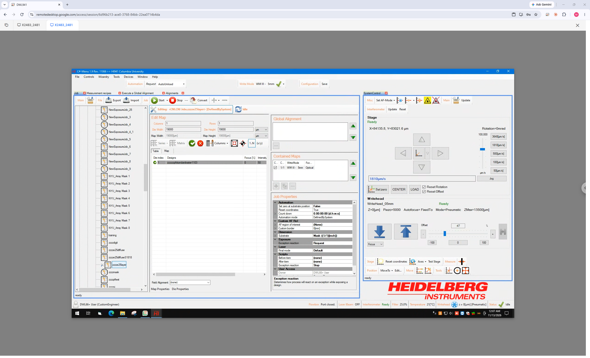
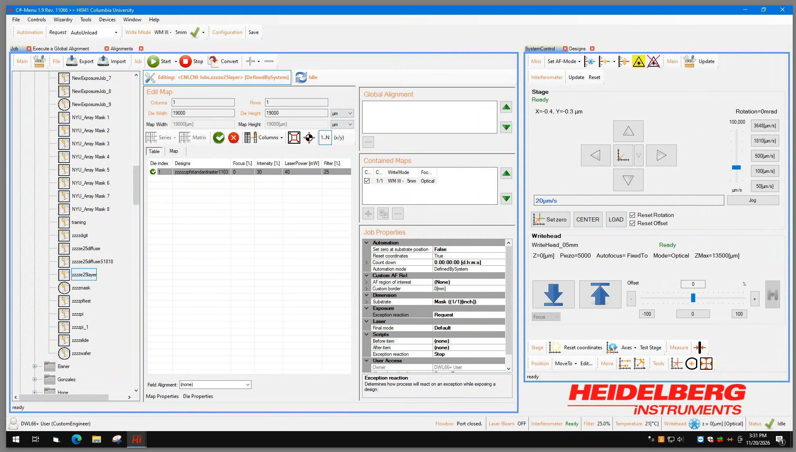
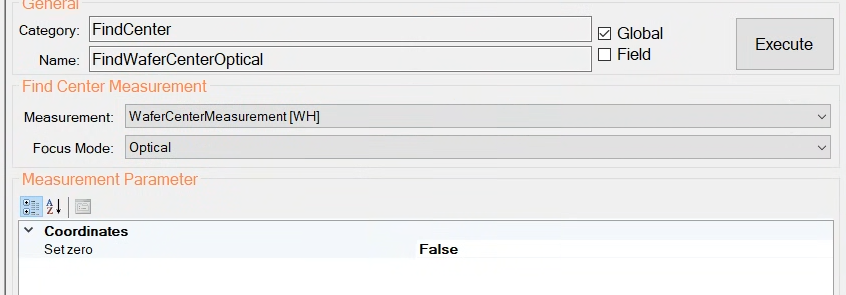

# Intro

This repo contains a python script that will autonomously execute a step-and-expose cycle for a 6x6 grid of patterns on a DWL 66+ Laserwriter lithography machine.

You'd think we could use the machine's built in stepping function, but because our dies are individual objects (normally you cut them out of a larger wafer after), we can not use the internal stepper because it naively jogs between dies, and in our case it might crash into the edge of the next die since they can be at slightly different Z heights and also the head auto moves up and down trying to autofocus while moving.

You'd think we could just add a before/after script to move the head up/down between moves, but apparently it is impossible to get any info on the scripting language for this machine :( .

Note that the skeleton for this code was created using [this very nice script recording tool](https://github.com/bigjosh/playwright-script-recorder) that I created exactly for automating tasks over a Chrome Remote Desktop connection.

# Installation

Tell your AI to follow the instructions in [install.md](install.md)

# Each burn cycle

## On local computer

1. Start an instance of Chrome with Remote Debugging on port 9222
   `start "" "C:\Program Files\Google\Chrome\Application\chrome.exe" --remote-debugging-port=9222 --user-data-dir=C:\crd-data-dir`
2. Log into Dirty Miles' Googlely account
3. Goto Chrome Remote Desktop and connect to the machine in the clean room.
4. Make sure that sleep is disabled! A full 36 disk cycle takes about 12 hours and you will be sad if the machine falls asleep in the middle.

## On laserWriter machine

Do these before starting the script

* Load 36 disks into tray and tray in machine
* Start with machine in LOAD position
* Pull up the Laser Write software on the RIGHTHAND monitor. Must be full screen and should look like this...
    
* Check that the Control tabs are Job, Execute a Global Alignment, and Aligments just like this...
    
* Set up the global alignment panel to option P1
* In the FindWaferCenterOptical panel, make sure `Set Zero` is `Flase`...
    
* Check Reset Offset and Reset Rotation beside CENTER for calibrated moves.
* Make sure the right job is loaded on the Jobs tab (currently `zzzzzzzpfstandardraster1103`)


# Start Script

`python real-dwl.py`

The script starts in single step mode so you have to click next for each step.

Once you feel confident that it is working, then you can click the button to run continuously. It will sound an alarm and stop if any tests fail.

# Coordinate System


Mapping and ordering with current tray:
```
spacing, plate_to_stage = load_plate_calibration("plate-calibration.json")

# Row 0 is the line of disks closest to the machgine door
# Col 0 is the row of disks closest to the left side of the machine when looking at it from the front

for r in range(0, 6):

    for c in range(0, 6):

        psl.info(f"*** Starting cycle for row {r}, column {c} ***")

        local_xy = plate_position(r, c, spacing)
        stage_x, stage_y = plate_to_stage.apply(local_xy)
        xpos, ypos = str(round(stage_x)), str(round(stage_y))
```


# Notes on co ord transform

Production verifies the calibrated move, focuses once, then clicks Set zero
at the disk center and checks the X/Y readout before starting the exposure.

